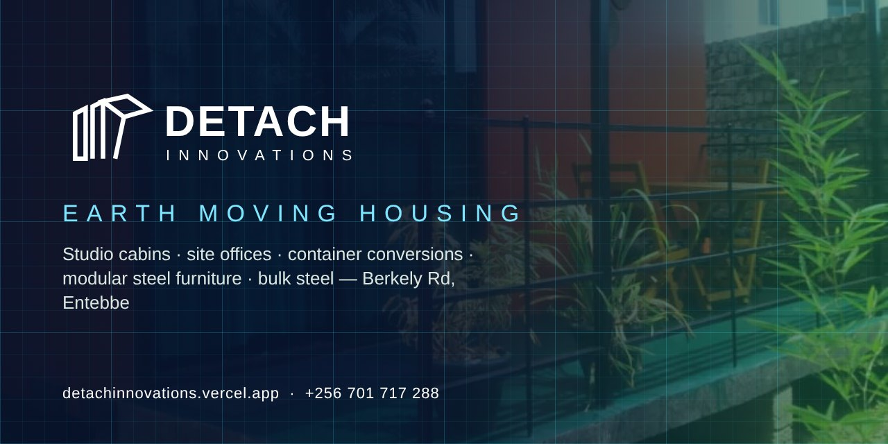

<p align="center">
  
</p>

<h3 align="center">Earth Moving Housing</h3>

<p align="center">
  Studio cabins · site offices · container conversions · modular steel furniture · bulk steel supply<br>
  Fabricated on Berkely Rd, Entebbe — delivered and fitted anywhere in Uganda.
</p>

<p align="center">
  <a href="https://detachinnovations.vercel.app"><b>🌐 detachinnovations.vercel.app</b></a>
  &nbsp;·&nbsp;
  <a href="https://wa.me/256701717288">💬 WhatsApp</a>
  &nbsp;·&nbsp;
  <a href="https://detachinnovations.vercel.app/request">📝 Request a quote</a>
</p>

<p align="center">
  
</p>

---

## About Detach Innovations

Detach Innovations builds **earth moving housing**: mobile units on welded steel frames that are finished in our Entebbe yard and set down on yours. Units sit on blocks or plinths, so there's no slab to pour and they can move later.

Founded by **Buqirwa Jimie**, steeler and inventor, who also designed our modular steel furniture: one set of frames that becomes a bed, sofa, dining bench, bookshelf and storage closet.

### What we build

| Product | What it is |
| --- | --- |
| [Studio cabins](https://detachinnovations.vercel.app/products/studio-cabins) | One-room units with sleeping area, kitchenette, shower room and a railed deck — ready to live in |
| [Glass-panel cabins & site offices](https://detachinnovations.vercel.app/products/glass-panel-cabins) | Steel frame, insulated panels and wide glazing for offices, guard houses, stores and studios |
| [Container conversions](https://detachinnovations.vercel.app/products/container-conversions) | Shipping containers cut, framed and fitted out as shops, kiosks, offices and rooms |
| [Modular steel furniture](https://detachinnovations.vercel.app/products/modular-steel-furniture) | Welded frames that rearrange into bed, sofa, bench, shelving and storage |
| [Shade lounges](https://detachinnovations.vercel.app/products/shade-lounges) | Steel roof, shade-net walls and raised decks for cafés, waiting areas and gardens |
| [Steel materials](https://detachinnovations.vercel.app/steel) | Box and square tube, angle line, flat bar, round pipe, sheets and roofing from our bulk stock |

### How we build

1. **Measure & draw** — a scaled plan you approve before any steel is cut.
2. **Fabricate in Entebbe** — frames, panels, glazing, wiring and finishes done in our yard.
3. **Deliver & fit** — set level on blocks, connected, decks and trims finished.

## Contact

| | |
| --- | --- |
| **Company** | Detach Innovations |
| **Owner** | Buqirwa Jimie — Steeler / Inventor |
| **Phone & WhatsApp** | [+256 701 717 288](tel:+256701717288) · [Chat on WhatsApp](https://wa.me/256701717288) |
| **Email** | [buqirwajimie@gmail.com](mailto:buqirwajimie@gmail.com) |
| **Workshop** | Berkely Rd, Entebbe, Uganda |
| **Hours** | Mon – Sat, 8:00 – 18:00 |
| **Website** | [detachinnovations.vercel.app](https://detachinnovations.vercel.app) |

---

## For developers

Built on the same model as the Attitude Aviation portal: **Next.js 16** (App Router), **Tailwind CSS 4**, **Oswald** font, deployed on **Vercel** from `main`.

```bash
npm install
npm run dev      # http://localhost:3000
npm run build
```

### Where things live

| File | What to edit |
| --- | --- |
| `lib/brand.ts` | Company name, tagline, owner, phone, WhatsApp, email, address, hours, site URL, socials |
| `lib/products.ts` | Product catalogue, steel stock list, "How we build" steps |
| `lib/gallery-manifest.ts` | Photos in the gallery slideshow |
| `lib/projects.ts` | Built-in photos on the Projects page, with titles and categories |
| `lib/photo-traces.ts` | Blueprint lines for built-in photos (generated by `scripts/trace_photos.py`) |
| `supabase/migrations/` | Database tables and security rules |
| `components/Logo.tsx` | Logo used in the navbar, footer and splash |
| `public/images/` | Project photos (`.webp`) |
| `public/brand/` | Logo files (SVG/PNG) and the social preview image |

### Features

- Splash screen: an architectural elevation of a finished cabin, traced from its photo, that develops into the photo
- Every photo is drafted as a blueprint first: its own structural lines draw from the foundation up, sized to the photo's dimensions, then the photo develops. Tap to replay
- Gallery slideshow drafted the same way, slide by slide
- Projects page with filters: built-in photos plus any added in the admin portal
- Product catalogue with detail pages, steel supply page
- Quote form: saves the request, emails the team (optional) and opens WhatsApp with it filled in
- Admin portal at `/admin`: quote inbox with status and notes, photo uploads (traced automatically in the browser), product prices, descriptions and hiding
- Sitemap, robots.txt and LocalBusiness structured data for Google

### Admin portal and database

Data lives in the **Detach Innovations** Supabase project. Vercel needs:

| Variable | What it is |
| --- | --- |
| `NEXT_PUBLIC_SUPABASE_URL` | Supabase project URL |
| `NEXT_PUBLIC_SUPABASE_ANON_KEY` | Supabase publishable key (safe in the browser; row-level security protects the data) |
| `RESEND_API_KEY` | Optional. Resend key, to email each quote request |
| `QUOTE_NOTIFY_EMAIL` | Optional. Who gets those emails (comma-separated) |
| `QUOTE_FROM_EMAIL` | Optional. Sender address on a domain verified in Resend |

**Adding an admin:** in Supabase, Authentication → Users → Add user (email and password). Then in the SQL editor:

```sql
insert into public.admins (user_id)
select id from auth.users where email = 'name@example.com';
```

Without the Supabase variables the site still works on its built-in data, and the quote form still opens WhatsApp.

**New built-in photos:** add them to `public/images`, list them in `lib/projects.ts` or `lib/gallery-manifest.ts`, then run `python scripts/trace_photos.py`.

### Pages

`/` · `/products` · `/products/[slug]` · `/projects` · `/steel` · `/about` · `/contact` · `/request` · `/admin`

---

<p align="center">
  Powered and rendered by <b>thee AGENCY Consults (UG) Limited</b> — <i>Innovation Unleashed</i><br>
  <a href="mailto:ainegb05@gmail.com">ainegb05@gmail.com</a> · <a href="https://wa.me/256742701202">WhatsApp +256 742 701 202</a>
</p>
